# Memoria 1. Fundamentos, versionamiento y tracking

**Asignatura:** MLOps  
**Programa:** Maestría en Ciencia de Datos  
**Integrantes:** Duvan Cruz, Natalia Mesa y Paula Laiton  
**Repositorio:** https://github.com/DuvanCruzMendoza/mlops-proyecto

## 1. Objetivo

Configurar un entorno de trabajo colaborativo y reproducible para el desarrollo de un proyecto de machine learning, mediante el uso de GitHub para el control de versiones, Poetry para la gestión de dependencias y Docker Compose para la ejecución de los servicios de Prefect y MLflow.

En esta etapa se buscó establecer la infraestructura básica del proyecto, verificar la comunicación entre las herramientas de orquestación y seguimiento de experimentos, definir el caso de uso con datos reales y registrar un primer experimento con trazabilidad. Esta base sustenta las actividades 2 a 4, en las que el mismo caso de uso se convertirá en una pipeline empaquetada, monitoreada y desplegada.

**Caso de uso.** El equipo trabaja en el DANE, en las encuestas económicas de industria, comercio y servicios. Por ello se planteó un problema propio del área: **imputar la producción bruta de los establecimientos de la Encuesta Anual Manufacturera (EAM)**. El modelo estima la producción bruta (`PRODBIND`) de un establecimiento a partir de variables que suelen estar disponibles (personal, salarios, energía eléctrica, activos, actividad CIIU, departamento y la producción del año anterior). Sirve para imputar la producción cuando no se reporta y para marcar los valores reportados que se alejan mucho del valor esperado.

## 2. Descripción del trabajo

### Paso 1. Estructura del repositorio y configuración del entorno

Se creó el repositorio `mlops-proyecto` en GitHub y se incorporó a Natalia Mesa y Paula Laiton como colaboradoras. Posteriormente, se realizó la clonación local del repositorio y se organizó la estructura inicial del proyecto.

La estructura quedó conformada por las carpetas `configs/`, `docs/`, `flows/`, `notebooks/`, `scripts/` y `tests/`, junto con los archivos `README.md`, `.gitignore`, `pyproject.toml` y `poetry.lock`. Se incorporaron archivos `__init__.py` en las carpetas para conservarlas bajo control de versiones, siguiendo la indicación de la actividad.

Para gestionar el entorno se utilizó Poetry con Python 3.12.10 y se fijaron las siguientes dependencias:

| Dependencia | Versión |
|---|---|
| Prefect | 3.8.8 |
| MLflow | 3.17.0 |
| Scikit-learn | 1.9.1 |
| Pandas | 3.0.6 |
| NumPy | 2.5.4 |
| PyYAML | 6.0.3 |
| openpyxl (agregada en el paso 2) | 3.1.5 |
| Pytest (desarrollo) | 9.1.1 |

Se configuró `package-mode = false` en `pyproject.toml`, dado que el proyecto no requiere instalarse como una librería de Python. Asimismo, se actualizaron las reglas de `.gitignore` para excluir el entorno virtual y los archivos locales generados por MLflow.

Finalmente, se completó el README con las instrucciones para clonar el repositorio, instalar las dependencias y ejecutar la validación de los servicios. Los cambios se publicaron en la rama `main`.

Natalia y Paula aceptaron las invitaciones, clonaron el repositorio y reprodujeron el entorno en sus propios equipos con poetry install. Ellas confirmaron que el poetry.lock funciona con distintas versiones dentro del rango del proyecto (figuras 4 y 5).


### Paso 2. Caso de uso y carga de datos

**Selección de los datos.** Se evaluaron varias fuentes publicadas por el DANE en el Archivo Nacional de Datos (ANDA) y se eligieron los microdatos anonimizados de la **EAM 2020 a 2024**: cinco archivos Excel, uno por año, con las mismas 386 columnas y entre 6.583 y 7.343 establecimientos por año. Antes de decidir, se comprobó con los datos que el identificador anonimizado del establecimiento (`nordest`) permite seguir a la misma unidad entre años: conserva el departamento en el 99,7 % de los casos y el CIIU entre el 96 % y el 98 %, y la producción de un año a otro tiene una correlación de 0,96. Esto habilita usar la producción del año anterior como variable.

**Script de carga.** Se adaptó `scripts/load_data.py` del repositorio del curso. El script:

1. Lee los cinco Excel de `data/raw/`. La carpeta, el patrón del nombre y los años se definen en `configs/config.yaml`, no en el código.
2. Conserva 16 de las 386 columnas: identificadores (`nordemp`, `nordest`, `periodo`), categóricas (`dpto`, `ciiu4`), diez variables numéricas y el objetivo `PRODBIND`.
3. Valida que estén todas las columnas, que `periodo` coincida con el año del archivo y que no haya establecimientos repetidos. Si algo falla, se detiene con un mensaje claro.
4. Descarta los registros con producción menor o igual a cero (uno en 2020), porque el objetivo se modela en logaritmo.
5. Une los años y guarda un CSV en `data/processed/eam_2020_2024.csv`.

Los Excel y el CSV no se versionan (`data/raw/` y `data/processed/` están en `.gitignore`). En su lugar, `data/README.md` documenta la fuente, cómo descargar los archivos y qué columnas se usan. Se añadió la dependencia `openpyxl==3.1.5`, necesaria para que pandas lea Excel.

**Pruebas.** Se creó `tests/test_data.py` con seis pruebas: dos con los datos reales (columnas, años, objetivo positivo, sin duplicados) y cuatro con Excel pequeños generados en la prueba (unión de años, columna faltante, archivo faltante y descarte de producción no positiva). Las dos primeras se omiten automáticamente si un integrante todavía no tiene los Excel.

### Paso 3. Levantamiento de servicios y comprobación de Prefect y MLflow

Se utilizó la opción A de la guía del curso, basada en Docker Compose. Desde la carpeta `services/` del material proporcionado por el profesor, se ejecutó:

`docker compose up -d`

Docker descargó las imágenes de MLflow 3.17.0 y Prefect 3.8.8, creó la red y el volumen requeridos e inició los dos contenedores.

Posteriormente, se comprobó el acceso a las interfaces web de MLflow (`http://localhost:5000`) y Prefect (`http://localhost:4200`).

Para validar la integración se copió el archivo `prueba_flow.py` del repositorio del curso a la carpeta `flows/` del proyecto. Desde PowerShell se configuraron las variables `PREFECT_API_URL` y `MLFLOW_TRACKING_URI`, apuntando a los servicios locales, y se ejecutó:

`poetry run python flows/prueba_flow.py`

La ejecución finalizó correctamente. Prefect registró el flujo `prueba` con estado `Completed` y el mensaje `Suma de 1 a 5 = 15`. Por su parte, MLflow creó el experimento `prueba-validacion` y registró la ejecución `prueba-mlflow`, con el parámetro `n = 5` y la métrica `suma = 15`.

El archivo de validación también fue incorporado al repositorio y publicado en GitHub.

### Paso 4. Pipeline de entrenamiento en Prefect con tracking en MLflow

Se construyó `flows/experimento_flow.py`, adaptado de la pipeline de ejemplo del curso. El flow `eam-imputacion-v1` tiene tres tareas:

1. **`cargar_datos`:** usa `load_data.py` (lee el CSV unificado o, si no existe, lo genera desde los Excel) y escribe en los logs de Prefect el número de filas, de establecimientos y de filas por año.
2. **`entrenar_y_registrar`:** construye las variables, divide los datos por año (entrena con 2020–2023 y evalúa con 2024), entrena el modelo, lo compara con una línea base y registra en MLflow los parámetros, el tamaño del dataset, las métricas y el modelo.
3. **Resumen:** crea en Prefect el artefacto Markdown `eam-imputacion-v1` con el modelo, las métricas y el ID del run de MLflow.

La construcción de variables, la línea base y las métricas se separaron en `scripts/features.py`:

- Las variables monetarias y de personal se transforman con logaritmo, porque tienen colas muy largas. El objetivo es `log(PRODBIND)`.
- Con `usar_rezago: true` se agregan la producción del año anterior del mismo establecimiento y los cambios anuales en personal, salarios y energía. Así solo quedan las filas que tienen año anterior (2021 en adelante).
- La línea base es la producción del año anterior (con rezago) o la mediana del CIIU en entrenamiento (sin rezago).

El modelo se arma como un `Pipeline` de scikit-learn: escalado de las variables numéricas, codificación one-hot de `dpto`, `ciiu2` y `ciiu4`, y el estimador elegido en `config.yaml` (`hist_gradient_boosting` o `ridge`). Se crearon siete pruebas en `tests/test_experimento_flow.py`, que usan un panel sintético y una base temporal de MLflow, por lo que no escriben en el servidor del curso.

Estructura final del repositorio:

```text
mlops-proyecto/
├── configs/config.yaml           # datos, división, variables, modelo y MLflow
├── data/README.md                # fuente y descarga de los datos (raw/ y processed/ no se versionan)
├── flows/
│   ├── prueba_flow.py            # validación de servicios (paso 3)
│   └── experimento_flow.py       # flow del modelo de imputación (paso 4)
├── scripts/
│   ├── load_data.py              # carga, validación y unificación de la EAM (paso 2)
│   └── features.py               # variables, división por año, línea base y métricas (paso 4)
├── tests/
│   ├── test_data.py              # 6 pruebas de la carga de datos
│   └── test_experimento_flow.py  # 7 pruebas del entrenamiento y del flow
├── docs/  notebooks/
├── README.md  .gitignore  pyproject.toml  poetry.lock
```

Con los servicios levantados y las dos variables de entorno definidas, el flow se ejecutó con:

`poetry run python flows/experimento_flow.py`

## 3. Decisiones técnicas

**Gestión de dependencias con Poetry.** Se utilizó Poetry, conforme a las instrucciones del curso, para centralizar las dependencias en `pyproject.toml` y conservar sus versiones resueltas en `poetry.lock`. Frente a la instalación manual de paquetes, este mecanismo facilita la reproducción del entorno en los computadores de los integrantes.

**Versiones fijadas de las librerías.** Se adoptaron las versiones exactas indicadas por el profesor, en lugar de mantener versiones más recientes seleccionadas inicialmente. Esta decisión permite alinear el proyecto con el entorno previsto para las actividades del curso y reducir diferencias de compatibilidad.

**Ejecución de servicios mediante Docker Compose.** La guía contemplaba dos alternativas: contenedores Docker o ejecución directa en Python. Se seleccionó Docker Compose porque Docker Desktop estaba disponible y permitía iniciar ambos servicios mediante una configuración común. Se descartó utilizar simultáneamente la alternativa sin Docker para evitar conflictos de puertos.

**Separación entre servicios y código del proyecto.** Se mantuvo la carpeta `services/` dentro del material del curso, independiente del repositorio `mlops-proyecto`. De esta manera, el repositorio del equipo conserva su código, configuración y dependencias, mientras que la infraestructura de servicios utiliza la configuración suministrada por el profesor.

**Archivos de inicialización de carpetas.** Inicialmente se utilizaron archivos `.gitkeep` para versionar carpetas vacías. Posteriormente se sustituyeron por `__init__.py` para ajustarse a la estructura indicada en la actividad. Ambas alternativas permiten conservar las carpetas en Git, pero se priorizó el cumplimiento de la instrucción del taller.

**Caso de uso del área en lugar de un dataset de Kaggle.** La actividad sugiere como ideal un problema propio del área de trabajo. Se consideraron datasets públicos (Bank Marketing, Telco Churn) y cuatro alternativas con datos del DANE: imputación con la EAM, nowcasting de índices mensuales, clasificación del crecimiento de establecimientos y detección de valores unitarios atípicos en exportaciones. El nowcasting se descartó por tener pocas observaciones (cientos de meses), y la detección de atípicos, porque no tiene etiquetas reales y exigía inyectar errores artificiales para medirla.

**Imputación frente a crecimiento de establecimientos.** Las dos opciones finalistas se probaron con los datos antes de decidir. El clasificador de crecimiento (¿la producción sube el año siguiente?) obtuvo un AUC de 0,52 a 0,54, prácticamente azar. Además, la proporción de establecimientos que crecen cambió de 81 % en 2020→2021 a 50 % en 2023→2024, por efecto de la inflación y la recuperación tras la pandemia. La imputación, en cambio, superó a una línea base razonable, por lo que fue la opción elegida.

**Uso exclusivo de microdatos anonimizados y públicos.** Aunque el equipo tiene acceso a información interna de las encuestas, se usaron solo las bases anonimizadas publicadas en el ANDA. La información interna está protegida por la reserva estadística, y el repositorio se comparte con terceros. Por la misma razón, y por su tamaño, los datos no se versionan: se documenta su fuente y se reconstruyen con `load_data.py`.

**Variables excluidas del modelo.** No se usan el consumo intermedio, las ventas ni el valor agregado. Esas variables forman parte de la producción por identidad contable, así que el modelo acertaría casi siempre sin aprender nada útil. Además, en una imputación real suelen faltar junto con la producción.

**División por año en lugar de aleatoria.** El ejemplo del curso usa `train_test_split` aleatorio. Aquí se entrena con 2020–2023 y se evalúa con 2024, para simular la llegada de un año nuevo de datos, que es como se usaría el modelo en la encuesta. Una división aleatoria mezclaría años y daría una estimación optimista del error.

**Métricas de regresión y comparación con línea base.** Las métricas de clasificación del ejemplo (AUC, recall) se reemplazaron por MAE y RMSE en logaritmo, el error porcentual mediano y el porcentaje de establecimientos con error menor al 20 %. Cada run registra también las métricas de la línea base, porque un MAE aislado no dice si el modelo aporta algo frente a usar simplemente el dato del año anterior.

**CSV unificado intermedio.** Leer los cinco Excel tarda varios segundos (más en Windows). Por eso `load_data.py` guarda un CSV de unos 3 MB que el flow lee casi de inmediato. Si el CSV no existe, el flow lo genera desde los Excel.

## 4. Evidencias

Las evidencias se organizan en cuatro grupos:

**Paso 1. Repositorio y entorno**

- **Figura 1.** Repositorio `mlops-proyecto` en GitHub, con su estructura y los archivos `README.md`, `pyproject.toml` y `poetry.lock`.

  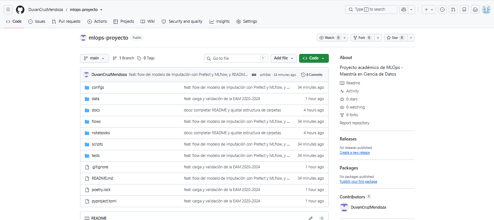

- **Figura 2.** Configuración de colaboradores en GitHub, con Natalia y Paula incorporadas al repositorio.

  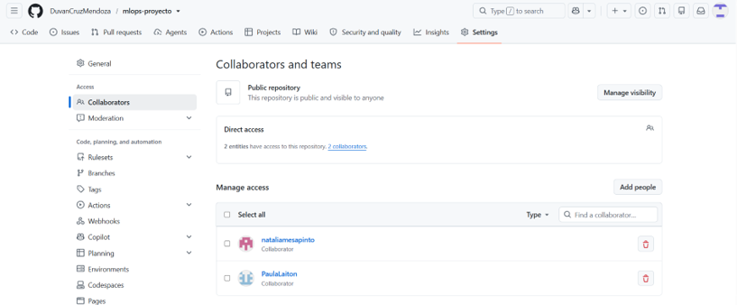

- **Figura 3.** Instalación y verificación del entorno con Poetry en el equipo donde se realizó la configuración inicial.

  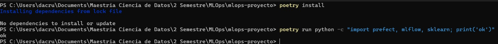

- **Figuras 4 y 5.** Verificación de `poetry install` en las clonaciones de Natalia y Paula.

  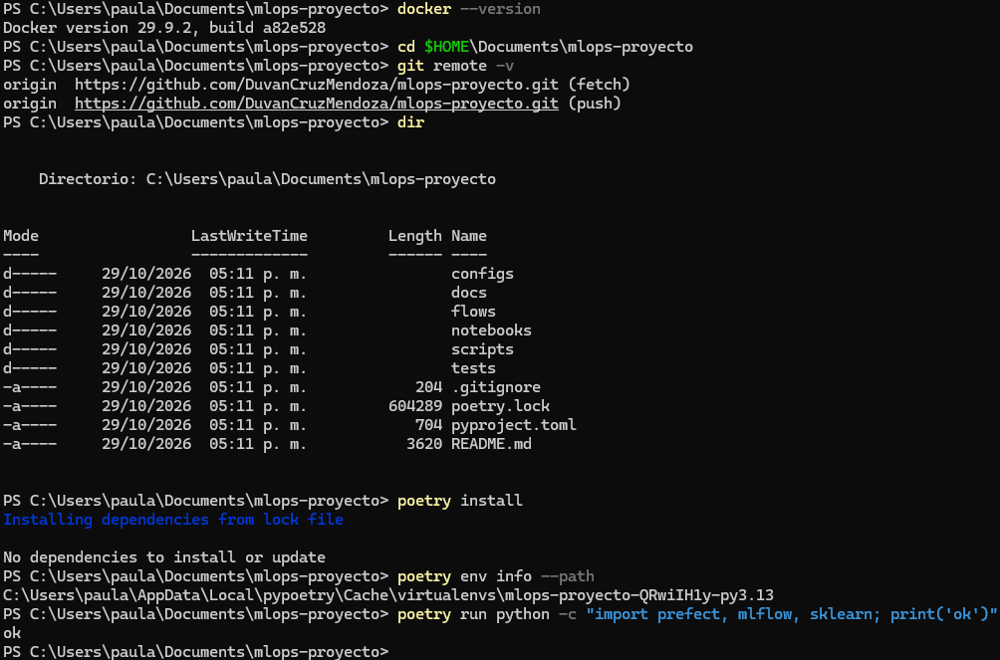

  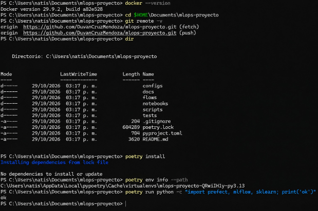


**Paso 2. Datos**

- **Figura 6.** `git status` antes del commit, que muestra que los Excel y el CSV no se versionan, y publicación del commit `dd52b82`.

  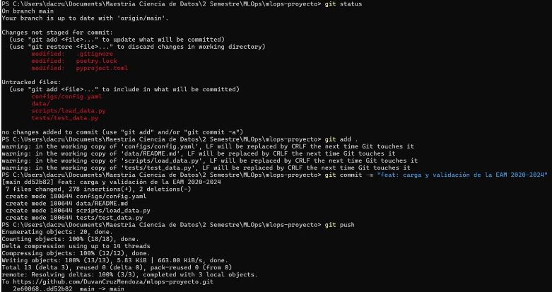

**Paso 3. Servicios y ejecución del flujo de prueba**

- **Figura 7.** Ejecución del flujo `prueba` en Prefect, con estado `Completed` y el log `Suma de 1 a 5 = 15`.

  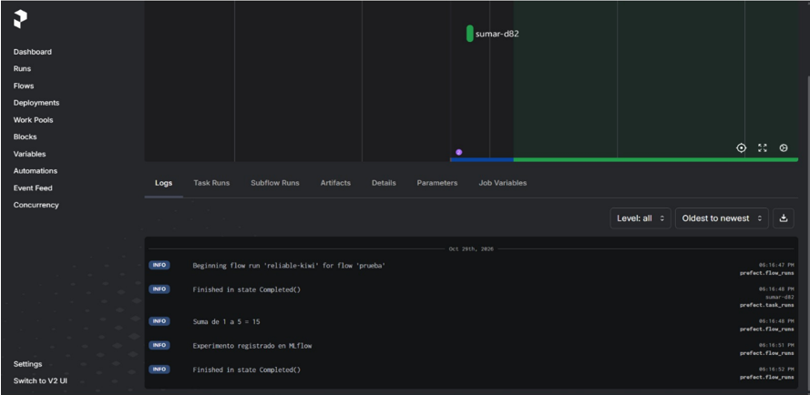

- **Figura 8.** Ejecución `prueba-mlflow` en MLflow, con el parámetro `n = 5` y la métrica `suma = 15`.

  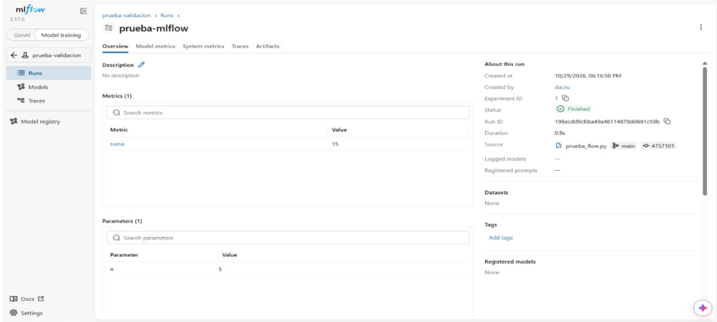

**Paso 4. Pipeline de entrenamiento**

- **Figura 9.** Terminal con la ejecución de `experimento_flow.py`, que termina con `Run de MLflow: 9415279e… | MAE log = 0.2041 (línea base 0.2620)`.

  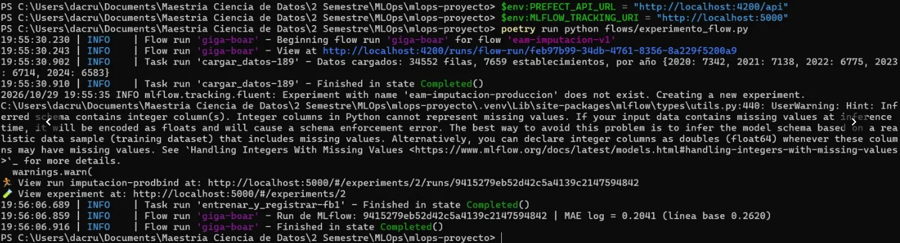

- **Figura 10.** Run `giga-boar` del flow `eam-imputacion-v1` en Prefect: estado `Completed`, 37 s y dos tareas en orden (`cargar_datos` → `entrenar_y_registrar`).

  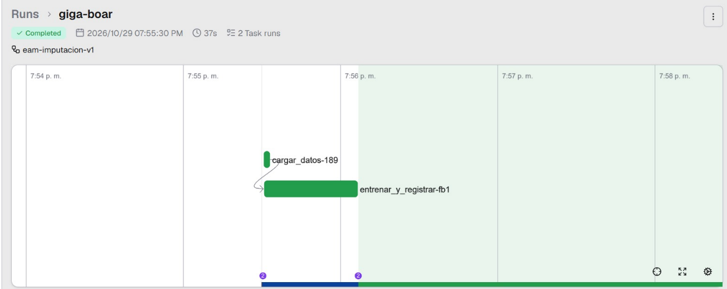

- **Figura 11.** Logs del run en Prefect, con `Datos cargados: 34552 filas, 7659 establecimientos…`.

  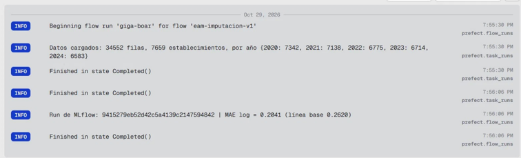

- **Figura 12.** Artefacto `eam-imputacion-v1` en Prefect, con su historial y su contenido (modelo, métricas e ID del run).

  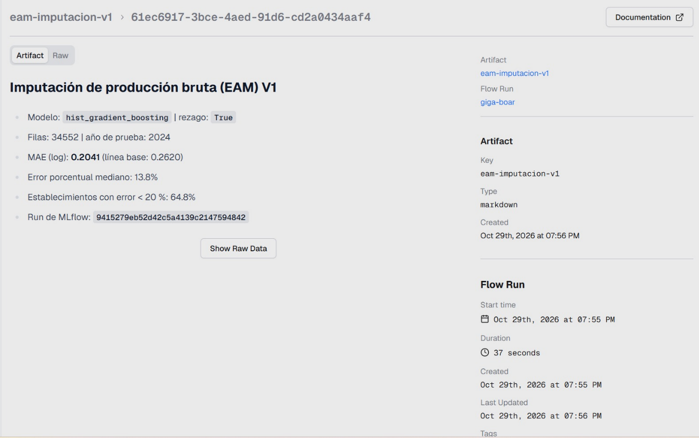

- **Figura 13.** Run `imputacion-prodbind` en MLflow (experimento `eam-imputacion-produccion`): parámetros, métricas y artefactos (`model` y `datos/resumen_datos.json`).

  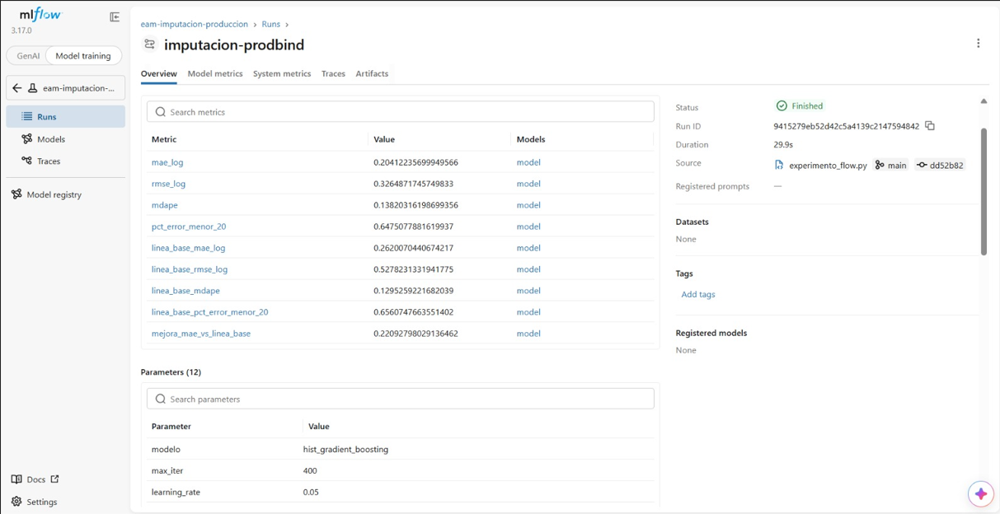

**Referencias del repositorio**

- Repositorio: https://github.com/DuvanCruzMendoza/mlops-proyecto
- Archivo de validación: https://github.com/DuvanCruzMendoza/mlops-proyecto/blob/main/flows/prueba_flow.py
- Flow del modelo: https://github.com/DuvanCruzMendoza/mlops-proyecto/blob/main/flows/experimento_flow.py
- Commit del flujo de prueba (paso 3): `2e60068`
- Commit de carga y validación de la EAM (paso 2): `dd52b82`
- Commit del flow del modelo y README actualizado (paso 4): `acfc9dc`
- ID del run de MLflow: `9415279eb52d42c5a4139c2147594842`

## 5. Resultados

**Validación de servicios (paso 3).** Los resultados de la validación fueron satisfactorios.

| Componente | Resultado obtenido |
|---|---|
| Repositorio GitHub | Creado y sincronizado en la rama `main` |
| Control de dependencias | Archivos `pyproject.toml` y `poetry.lock` publicados |
| Colaboración | Tres integrantes vinculados al repositorio |
| MLflow | Interfaz disponible en el puerto 5000 |
| Prefect | Interfaz disponible en el puerto 4200 |
| Flujo de prueba | Ejecución completada |
| Resultado de la tarea | Suma de 1 a 5 = 15 |
| Experimento MLflow | `prueba-validacion` |
| Parámetro registrado | `n = 5` |
| Métrica registrada | `suma = 15` |

Estas cifras corresponden a una prueba funcional de integración, no a métricas de desempeño de un modelo.

**Datos (paso 2).**

| Año | Establecimientos |
|---|---|
| 2020 | 7.342 |
| 2021 | 7.138 |
| 2022 | 6.775 |
| 2023 | 6.714 |
| 2024 | 6.583 |
| **Total** | **34.552 filas, 7.659 establecimientos distintos, 0 nulos** |

**Modelo de imputación (paso 4).** Se evaluó sobre los 6.420 establecimientos de 2024 que tienen dato de 2023. El entrenamiento usó 20.410 filas (2021–2023 con año anterior).

| Modelo | Rezago | MAE (log) | Línea base | Error porcentual mediano | Error < 20 % |
|---|---|---|---|---|---|
| **hist_gradient_boosting** | sí | **0,204** | 0,262 | 13,8 % | 64,8 % |

Interpretación:

- El modelo con rezago reduce el MAE en 22 % frente a usar solo el dato del año anterior (0,204 frente a 0,262).
- El error porcentual mediano del modelo (13,8 %) es similar al de la línea base, pero el modelo tiene menos errores grandes. Por eso el MAE baja aunque la mediana casi no cambie.
- Sin el dato del año anterior, el error se duplica (0,432). La información histórica del establecimiento es la variable más valiosa para imputar.
- Un modelo entrenado solo con 2020 empeora al evaluarlo en años posteriores (MAE de 0,47 en 2021 y 0,55 en 2022), según el análisis exploratorio. Hay *drift* entre años, que se abordará en el módulo de monitoreo.

## 6. Problemas encontrados

Durante la configuración inicial se presentaron dificultades relacionadas con la instalación de dependencias y la definición del entorno virtual. Estas se resolvieron mediante la reconstrucción del entorno y la verificación de las librerías instaladas.

Adicionalmente, **después del segundo commit se identificó que no se habían aplicado las versiones específicas de las dependencias establecidas en el taller**. Para corregirlo, se actualizaron las versiones en `pyproject.toml` y `poetry.lock`, y se verificó el estado del entorno mediante `poetry check`, la comprobación de dependencias y la importación de las principales librerías. Los ajustes quedaron registrados en el historial de GitHub.

También fue necesario ajustar la estructura de las carpetas, sustituyendo los archivos `.gitkeep` por `__init__.py`, y corregir el formato del README antes de publicarlo.


En los pasos 2 y 4 se presentaron los siguientes problemas:

- **Lectura de Excel.** pandas necesita `openpyxl` para leer `.xlsx`, y no estaba entre las dependencias del curso. Se agregó con versión fijada (`poetry add "openpyxl==3.1.5"`).
- **Pruebas lentas.** `pytest` tardó cerca de 100 segundos, porque las pruebas con datos reales leen los cinco Excel y en Windows openpyxl es lento. Se mantuvo así, porque esas pruebas se omiten cuando no hay datos, como ocurrirá en la integración continua de la actividad 3.
- **Importación de `scripts` desde el flow.** En el repositorio del curso, `scripts` está instalado como paquete (`package-mode = true`), pero en este proyecto se usa `package-mode = false`. Al ejecutar `python flows/experimento_flow.py`, Python no encontraba la carpeta (`ModuleNotFoundError: No module named 'scripts'`). Se resolvió agregando la raíz del repositorio a la ruta de búsqueda al inicio del flow, para conservar el mismo comando de ejecución del curso.
- **Registro del modelo en MLflow 3.17.** MLflow guarda los modelos de scikit-learn con el formato `skops` y rechazó un tipo interno de `HistGradientBoostingRegressor` por no estar declarado como confiable. Se declaró explícitamente con `skops_trusted_types`, lo cual es seguro porque el modelo se entrena en el mismo run.
- **Advertencias no bloqueantes.** MLflow advirtió que algunas columnas de entrada son enteras (`dpto`, `ciiu4`) y no admiten nulos. No afecta, porque esas columnas no tienen vacíos en la EAM. Git mostró avisos de conversión de fin de línea (LF a CRLF) por trabajar en Windows con archivos creados en otro sistema, y tampoco afectan el contenido.
- **Visualización del artefacto en Prefect.** En la pestaña *Artifacts* del run solo aparece una tarjeta resumida. Para ver el contenido hubo que abrir el artefacto y luego su versión en el historial.

## 7. Conclusiones

La configuración realizada permitió establecer una base de trabajo versionada y reproducible, con las dependencias y herramientas requeridas para continuar el desarrollo del proyecto durante el semestre.

La validación mediante `prueba_flow.py` confirmó el funcionamiento de Prefect y MLflow, así como la comunicación entre el código ejecutado localmente y los servicios desplegados mediante Docker Compose.

El proceso también evidenció la importancia de revisar las versiones y la estructura exigidas antes de configurar el entorno, para evitar ajustes posteriores. El uso de Git permitió conservar la trazabilidad de estas correcciones.

Con los pasos 2 y 4 el proyecto pasó de una prueba funcional a un experimento real. El MAE de 0,2041 obtenido en el computador del equipo coincidió con el de la ejecución de referencia, lo que confirma el criterio de éxito de la actividad: otra persona clona el repositorio, instala el entorno y reproduce el experimento. Haber probado las alternativas con los datos antes de elegir evitó trabajar todo el semestre con un problema sin señal predictiva, como el de crecimiento. Además, comparar cada run con una línea base hizo que las métricas registradas en MLflow fueran interpretables.

Con más tiempo o recursos se mejoraría:

- **Deflactar los valores monetarios** (por ejemplo con el IPP), para que el modelo sea más estable entre años con distinta inflación.
- **Medir la incertidumbre de cada imputación**, por ejemplo con intervalos de predicción, para priorizar la revisión de los valores reportados más alejados.
- **Probar otros modelos y ajustar hiperparámetros**, aprovechando la comparación de runs en MLflow.
- **Registrar el modelo en el Model Registry de MLflow** y empaquetar la pipeline, como parte de la actividad 2.

## 8. Uso de herramientas de inteligencia artificial

**Pasos 1 y 3.** Se utilizó **ChatGPT** como herramienta de apoyo para interpretar las instrucciones del taller, orientar la ejecución de comandos, revisar resultados de terminal, identificar problemas de configuración y estructurar la documentación del proyecto.

La configuración del repositorio, la ejecución de los comandos, la instalación de dependencias, la puesta en marcha de Docker y la validación de las interfaces fueron realizadas directamente por el integrante encargado de la configuración inicial. La creación del repositorio, la configuración inicial de Poetry y la primera puesta en marcha de los servicios fueron realizadas por Duván. Natalia y Paula instalaron de forma independiente Python, Poetry, Git y Docker Desktop (con WSL 2), clonaron el repositorio, reprodujeron el entorno con poetry install y validaron los servicios en sus propios equipos. Adicionalmente, conjuntamente se ejecutó el MLflow y Prefect desde su carpeta services/ y ejecutó prueba_flow.py, obteniendo los mismos resultados. Finalmente, Paula y Natalia, tomaron las evidencias correspondientes.

Las recomendaciones de la herramienta de IA fueron contrastadas con las instrucciones del profesor. Como resultado de esa revisión, se corrigieron las versiones de dependencias, se ajustaron los archivos de las carpetas y se depuró el README. Se decidió desarrollar los pasos 2 y 4, aunque eran recomendados, para adelantar el caso de uso.

**Pasos 2 y 4.** Se utilizó **Claude** (Anthropic) para:

- Escribir el código de `load_data.py`, `features.py`, `experimento_flow.py`, las pruebas, `data/README.md` y la actualización del README, adaptando los scripts del repositorio del curso.
- Probar el código con las versiones de dependencias del curso antes de entregarlo al equipo, y explicar paso a paso su instalación, ejecución y publicación.

**Trabajo realizado por el equipo sin IA:** la definición del área y del problema (encuestas económicas del DANE), la descarga de las bases anonimizadas del ANDA, la decisión final entre las alternativas propuestas, la ejecución de todos los comandos en el entorno propio (instalación, carga, pruebas, flow, commits y publicación), la revisión de los resultados en las interfaces de Prefect y MLflow, y la toma de las capturas.

- Se descartaron varias propuestas de datos (datasets de Kaggle, exportaciones, nowcasting) y la opción de crecimiento, esta última tras comprobar con los datos que no tenía señal predictiva.
- Se evitó usar microdatos internos del DANE, en atención a la reserva estadística.
- Al probar el flow, el código entregado inicialmente presentó dos errores (la importación de `scripts` y el registro del modelo con `skops`), que se corrigieron antes de integrarlo al repositorio.
- El equipo verificó que los resultados obtenidos en su propio entorno (34.552 filas, MAE de 0,2041) coincidieran con los reportados, y solicitó aclaraciones sobre puntos que no estaban claros, como la carpeta `data/processed/`, el levantamiento de los servicios, las advertencias de Git y la visualización de los artefactos en Prefect, antes de aceptar los cambios.

