# Memoria 2. Automatización del entrenamiento, la inferencia y el servicio del modelo

**Actividad:** Actividad 2 — Pipelines de entrenamiento e inferencia con registro del modelo champion  
**Asignatura:** MLOps  
**Programa:** Maestría en Ciencia de Datos  
**Integrantes:**

- Duván Arley Cruz Mendoza
- Natalia Mesa Pinto
- Paula Angélica Laiton Monroy

**Proyecto:** Imputación de la producción bruta industrial (`PRODBIND`) con datos anonimizados de la Encuesta Anual Manufacturera (EAM)  
**Repositorio:** https://github.com/DuvanCruzMendoza/mlops-proyecto  
**Fecha de ejecuciones documentadas:** 7 y 8 de noviembre de 2026  
**Tecnologías:** Python, Poetry, Prefect, MLflow, scikit-learn, Pytest, FastAPI, Uvicorn, Docker, Git y GitHub.

## Alcance de la actividad

Esta memoria reúne el ciclo completo desarrollado por el equipo: **(I) entrenamiento y promoción controlada del modelo `champion`; (II) inferencia por lotes y despliegue diario; (III) servicio FastAPI con recarga de una versión mejorada del champion**, además de la **(IV) integración final** de los tres componentes. Cada parte conserva el detalle de ejecución, los resultados observados y las evidencias correspondientes.

**Organización de las evidencias:** figuras 1–7 (entrenamiento), 8–15 (inferencia y despliegue), 16–25 (API) y 26–27 (integración final). Las imágenes están en `docs/img/a2/`, junto a esta memoria.

### Cumplimiento de los requisitos de la actividad

| Requisito | Dónde se evidencia |
|---|---|
| Pipeline de entrenamiento en Prefect (ingesta → entrenamiento → evaluación → registro) con tag `fase=entrenamiento` | Parte I, secciones 5 y 6 (figuras 2–4) |
| Promoción a `champion` solo si supera un umbral mínimo y al champion actual (MAE en lugar de AUC, por ser regresión) | Parte I, sección 7 (figuras 5–6) |
| `configs/features.yaml` con los alias `ALL`, `NUMERIC` y `CUSTOM`, y registro de `features` y `n_features` | Parte I, secciones 4 y 6 (figuras 1 y 4) |
| Pipeline de inferencia que carga `@champion`, predice un lote y guarda un CSV con la fecha | Parte II, sección 5 (figura 9) |
| Dos despliegues separados en Prefect, con la inferencia programada a diario | Parte II, secciones 6 y 7 (figuras 10–13) |
| API FastAPI que sirve el champion, con predicción de ejemplo documentada | Parte III, secciones 4 y 6 (figuras 17–19) y `README.md` |
| **Criterio de éxito:** un nuevo entrenamiento crea una versión, el alias `champion` pasa a ella y la API responde con la nueva versión tras reiniciarse | Parte III, sección 7 (figuras 20–23) |
| Configuración en YAML, pruebas automatizadas y commits de los tres integrantes | Partes I–III (figuras 7, 8, 24 y 25) y Parte IV |

**Decisión sobre la métrica.** La actividad plantea un AUC mínimo para promover modelos. Como este proyecto estima un valor continuo (la producción bruta) y no una clase, el AUC no es aplicable; se usó el **MAE en escala logarítmica**, con un umbral máximo de 0,30, y se exigió además superar la línea base y al champion vigente (Parte I, sección 7.1).

---

## Parte I. Entrenamiento y registro del modelo champion — Duván

### 1. Objetivo y alcance

Se amplió el proyecto desarrollado en la primera actividad para automatizar la ingesta, el entrenamiento, la evaluación y el registro de modelos orientados a la estimación de la **producción bruta industrial (`PRODBIND`)**. Se incorporó la selección configurable de variables, el seguimiento de experimentos en MLflow y una regla de promoción que conserva el modelo identificado como `champion` mientras no exista un candidato con mejor desempeño.

Esta sección documenta el **componente de entrenamiento** y sus verificaciones. La inferencia programada, los despliegues y el servicio de predicción se documentan en las Partes II y III.

### 2. Verificación del entorno y preparación de datos

Se comprobó el entorno administrado con Poetry y la disponibilidad de Prefect, MLflow y scikit-learn:

```powershell
poetry install
poetry run python -c "import prefect, mlflow, sklearn; print('ENTORNO OK')"
Get-ChildItem data/raw -Name
```

La comprobación de dependencias devolvió `ENTORNO OK` y se verificó la existencia de los cinco archivos Excel de 2020 a 2024. Después se generó el archivo consolidado, se confirmó que los contenedores estaban activos y se definieron las variables de entorno:

```powershell
poetry run python scripts/load_data.py
docker ps
$env:PREFECT_API_URL = "http://localhost:4200/api"
$env:MLFLOW_TRACKING_URI = "http://localhost:5000"
```

La ingesta produjo `data/processed/eam_2020_2024.csv`, con **34.552 registros**, **7.659 establecimientos**, **16 columnas** y **cero valores nulos**. Se excluyó un registro con `PRODBIND` no positivo, debido a la transformación logarítmica aplicada a la variable objetivo. Se confirmó que los servicios de Prefect (`localhost:4200`) y MLflow (`localhost:5000`) estaban activos.

### 3. Componentes implementados

| Archivo | Propósito |
|---|---|
| `flows/entrenamiento_flow.py` | Orquestar ingesta, entrenamiento, evaluación, registro y promoción. |
| `configs/config.yaml` | Configurar datos, división temporal, candidatos, criterios de promoción y MLflow. |
| `configs/features.yaml` | Elegir la modalidad de selección de variables. |
| `scripts/features.py` | Preparar y construir variables predictoras. |
| `tests/conftest.py` | Proporcionar recursos compartidos para las pruebas. |
| `tests/test_entrenamiento_flow.py` | Validar el comportamiento del flujo de entrenamiento. |
| `tests/test_features.py` | Validar la preparación y selección de variables. |

Se retiraron `flows/experimento_flow.py` y `tests/test_experimento_flow.py`, correspondientes al flujo de la primera actividad, para mantener una única implementación de entrenamiento y pruebas coherentes con su interfaz actual. El flujo anterior se conserva en el historial de Git.

### 4. Selección configurable de variables

El archivo `configs/features.yaml` contempla tres modalidades:

- **`ALL`:** las diez variables numéricas, el departamento (`dpto`) y la actividad económica (`ciiu4` y su agregación a dos dígitos, `ciiu2`).
- **`NUMERIC`:** únicamente las diez variables numéricas.
- **`CUSTOM`:** variables elegidas explícitamente en la lista `custom`.

La configuración personalizada utilizada fue:

```yaml
seleccion: CUSTOM
custom:
  - PERSOCU
  - SALARPER
  - EELEC
  - ciiu4
```

Las variables seleccionadas corresponden a **`PERSOCU` (personal ocupado)**, **`SALARPER` (sueldos y salarios del personal permanente)**, **`EELEC` (energía eléctrica consumida)** y **`ciiu4` (actividad económica, código CIIU a cuatro dígitos)**.

Las demás variables numéricas de la modalidad `ALL` son `PERTOTAL` (personal total), `PRESSPER` (prestaciones sociales del personal permanente), `REMUTEMP` (remuneración del personal temporal), `PERAPREN` (aprendices), `ACTIVFI` (activos fijos), `DEPRECIA` (depreciación) e `INVEBRTA` (inversión bruta), según el diccionario de variables de la EAM publicado en el ANDA.

La opción de rezagos, controlada por `variables.usar_rezago` en `configs/config.yaml`, añade cuatro predictores construidos con el año anterior del mismo establecimiento: la producción, el personal ocupado, los salarios y el consumo de energía. Por ello, **el número de variables efectivamente utilizadas no coincide con la cantidad de códigos escritos en la configuración**:

| Modalidad | Numéricas | Rezagos | Categóricas | `n_features` |
|---|---:|---:|---:|---:|
| `ALL` | 10 | 4 | 3 (`dpto`, `ciiu2`, `ciiu4`) | **17** |
| `CUSTOM` | 3 | 4 | 2 (`ciiu2`, `ciiu4`) | **9** |

Las variables se cuentan como columnas de entrada, antes de la codificación *one-hot* de las categóricas. En MLflow se guardaron los parámetros `features` y `n_features` para identificar ambas configuraciones.

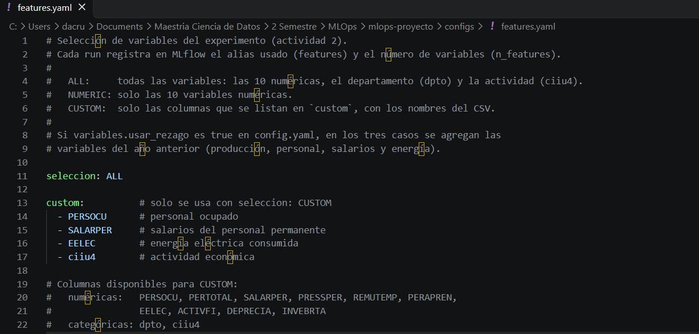

*Figura 1. Archivo de configuración con selección `ALL` como valor predeterminado y lista de variables para el modo `CUSTOM`.*

### 5. Orquestación del flujo con Prefect

El flujo `entrenamiento-eam` ejecuta cinco operaciones lógicas: **ingesta → entrenamiento → evaluación → registro en MLflow → promoción condicionada**. En cada ejecución se entrenan dos algoritmos, **Ridge** y **HistGradientBoostingRegressor**, y se comparan sus errores.

El entrenamiento utilizó **20.410 registros de 2021–2023** y la evaluación **6.420 registros de 2024**. Los datos de 2020 se emplearon como antecedente para la construcción de rezagos. Se utilizó el **error absoluto medio de la variable objetivo en escala logarítmica (`MAE log`)**: cuanto menor sea su valor, mejor es el resultado. La línea base, que estima la producción con la del año anterior, obtuvo un MAE de **0,2620**.

#### 5.1. Primera ejecución: modalidad ALL

Se ejecutó:

```powershell
poetry run python flows/entrenamiento_flow.py
```

Prefect creó la ejecución **`woodoo-chowchow`**, cuyas ocho tareas finalizaron en estado `Completed`. Son ocho porque las tareas de entrenamiento, evaluación y registro se ejecutan una vez por cada algoritmo: 1 de ingesta, 2 × 3 de los candidatos y 1 de promoción.

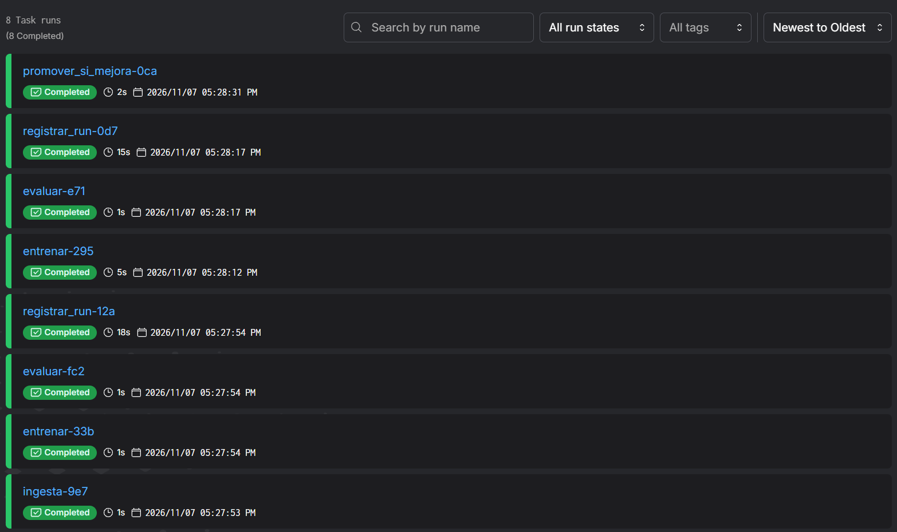

*Figura 2. Ejecución satisfactoria del flujo con selección `ALL`.*

| Algoritmo | Variables | MAE log |
|---|---:|---:|
| Ridge | 17 | 0,2391 |
| **HistGradientBoosting** | **17** | **0,2041** |
| Línea base | — | 0,2620 |

El algoritmo HistGradientBoosting obtuvo el menor MAE. MLflow creó el experimento `eam-imputacion-a2`, registró las ejecuciones `ridge-all` y `hgb-all` y creó el modelo registrado `eam-imputacion-prodbind`. Como aún no existía un `champion`, la **versión 1** recibió ese alias.

Mensaje de confirmación:

```text
Versión 1 es el nuevo champion (MAE 0.2041, primer champion)
Finished in state Completed()
```

#### 5.2. Segunda ejecución: modalidad CUSTOM

Se modificó temporalmente `seleccion: CUSTOM` y se volvió a ejecutar:

```powershell
poetry run python flows/entrenamiento_flow.py
```

Prefect creó la ejecución **`armored-frog`**, también con ocho tareas completadas.

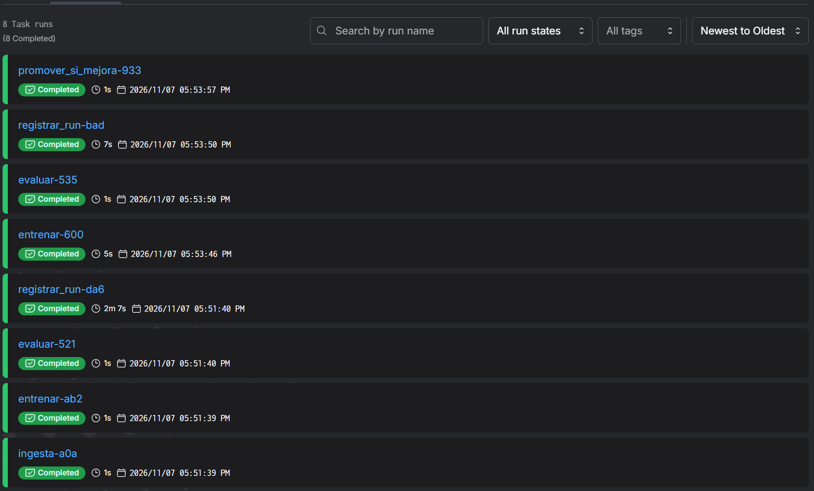

*Figura 3. Ejecución satisfactoria del flujo con selección `CUSTOM`.*

| Algoritmo | Variables | MAE log |
|---|---:|---:|
| Ridge | 9 | 0,2405 |
| **HistGradientBoosting** | **9** | **0,2131** |
| Línea base | — | 0,2620 |

Se registraron las ejecuciones `ridge-custom` y `hgb-custom`. Aunque el mejor modelo CUSTOM superó la línea base, su error fue mayor que el del `champion` existente.

### 6. Comparación y trazabilidad de experimentos en MLflow

Las cuatro ejecuciones quedaron disponibles en el experimento `eam-imputacion-a2`. Cada una lleva el tag **`fase = entrenamiento`**, la métrica `mae_log` y los parámetros `features` y `n_features`, además del modelo entrenado y un resumen de los datos utilizados como artefactos.

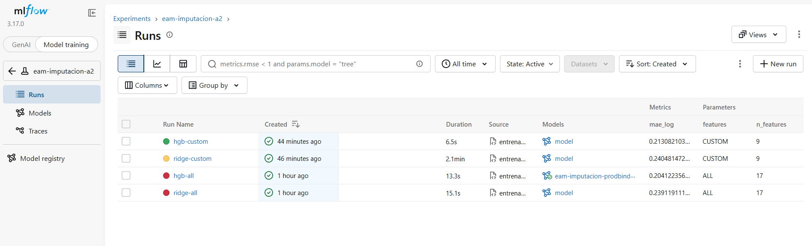

*Figura 4. Registro comparativo de modelos, configuraciones y métricas.*

| Ejecución | Configuración | Número de variables | MAE log |
|---|---|---:|---:|
| `ridge-all` | ALL | 17 | 0,2391 |
| **`hgb-all`** | **ALL** | **17** | **0,2041** |
| `ridge-custom` | CUSTOM | 9 | 0,2405 |
| `hgb-custom` | CUSTOM | 9 | 0,2131 |

La configuración `ALL` obtuvo los menores errores para ambos algoritmos, y HistGradientBoosting superó a Ridge en las dos modalidades. Estos resultados corresponden a la EAM 2020–2024 con la división temporal descrita; no permiten afirmar que `ALL` sea superior en cualquier conjunto de datos.

### 7. Validación de la promoción condicionada

#### 7.1. Criterio de promoción

La actividad plantea promover un modelo solo si supera un **AUC mínimo** y mejora al `champion` actual. Como este problema es de **regresión** (se estima un valor de producción y no una clase), el AUC no es aplicable y se reemplazó por el **MAE en escala logarítmica**. Un candidato se promueve a `champion` solo si cumple tres condiciones, configuradas en la sección `registro` de `configs/config.yaml`:

1. **Umbral mínimo de calidad:** `mae_log ≤ 0,30` (`max_mae_log`).
2. **Supera la línea base:** su MAE es menor que el de la producción del año anterior, 0,2620 (`exigir_superar_linea_base: true`).
3. **Mejora al `champion` actual:** su MAE es menor que el de la versión vigente.

En cada ejecución solo se evalúa el mejor candidato, y únicamente se registra una nueva versión en el Model Registry cuando se promueve. La versión promovida recibe el alias `champion` y la etiqueta `estado = aprobado`.

#### 7.2. Comprobación

En la segunda ejecución:

- **MAE del `champion` v1:** 0,2041.
- **MAE del mejor candidato CUSTOM:** 0,2131.
- **Decisión:** el candidato cumple las condiciones 1 y 2, pero no la 3. Se conserva la versión 1 y no se registra una versión nueva.

El registro de Prefect confirmó:

```text
MAE 0.2131 no mejora al champion v1 (0.2041): el alias no cambia
```

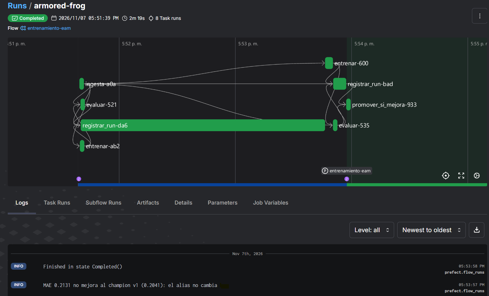

*Figura 5. Validación del mecanismo de no promoción cuando el candidato presenta mayor MAE.*

Se verificó además el alias directamente desde Python:

```powershell
poetry run python -c "import mlflow; mlflow.set_tracking_uri('http://localhost:5000'); m=mlflow.MlflowClient().get_model_version_by_alias('eam-imputacion-prodbind','champion'); print('Modelo:',m.name); print('Champion version:',m.version); print('Run ID:',m.run_id)"
```

Resultado:

```text
Modelo: eam-imputacion-prodbind
Champion version: 1
Run ID: 686da5b88937450eb0792c05d0cb5ef7
```

En el registro de modelos de MLflow, la versión 1 aparece con el alias `champion` y la etiqueta `estado: aprobado`.

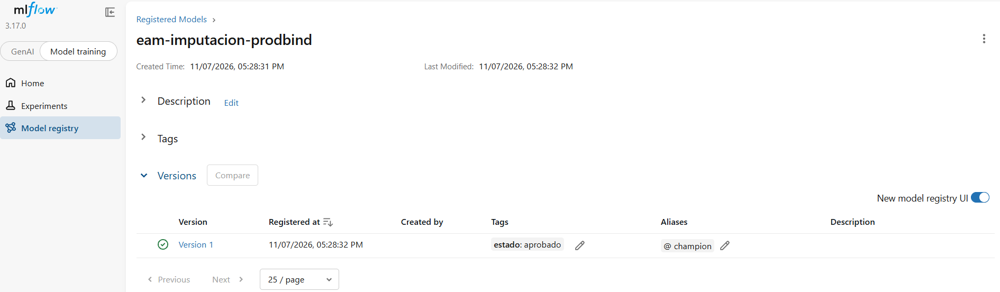

*Figura 6. Confirmación de la versión 1 como modelo vigente.*

El caso complementario, en el que un candidato mejora al `champion` y el alias pasa a una nueva versión, se demuestra en la Parte III (API): se entrena primero con `CUSTOM` (versión 1) y luego con `ALL` (versión 2), y la API responde con la nueva versión tras reiniciarse.

### 8. Pruebas automatizadas

Se ejecutó la batería de pruebas del repositorio:

```powershell
poetry run pytest -q
```

Resultado final:

```text
21 passed, 13 warnings in 419.04s (0:06:59)
```

**Las 21 pruebas finalizaron sin fallos.** Cubren la carga de datos, la resolución de las modalidades `ALL`, `NUMERIC` y `CUSTOM`, el registro en MLflow con el tag `fase = entrenamiento` y los parámetros `features` y `n_features`, y la regla de promoción. Las 13 advertencias provienen de una función obsoleta de SQLAlchemy utilizada por MLflow y de la inferencia de esquemas con columnas enteras; no afectan los resultados, pero la segunda se tendrá en cuenta en la inferencia si se reciben valores faltantes.

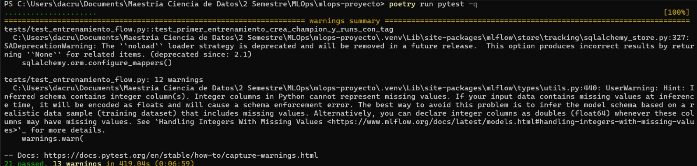

*Figura 7. Ejecución de la batería de pruebas automatizadas.*

### 9. Control de versiones y publicación

Se revisaron los cambios con Git y se publicaron los archivos actualizados:

```powershell
git add -A
git diff --cached --stat
git commit -m "Implementar flujo de entrenamiento y registro de champion en MLflow"
git push origin main
```

La operación registró **nueve archivos modificados, creados o eliminados**, con **521 inserciones y 286 eliminaciones**. El commit fue **`215cf1c`** y se publicó en la rama `main` del [repositorio del proyecto](https://github.com/DuvanCruzMendoza/mlops-proyecto). La documentación del entrenamiento en `README.md` se publicó junto con las secciones de inferencia y API en el commit de integración de la Parte III (`f58199f`).

Tras las pruebas de la modalidad CUSTOM, se restauró `seleccion: ALL` como valor predeterminado y se comprobó con `git status --short` que no quedaban cambios pendientes.

> **Alcance del registro:** GitHub contiene el código y las configuraciones; el modelo registrado, sus artefactos y el alias `champion` están en el servidor local de MLflow de cada integrante. Por eso, cada integrante ejecuta el entrenamiento en su equipo antes de probar la inferencia o la API.

### 10. Conclusiones

Se implementó y verificó un flujo reproducible de entrenamiento, evaluación, registro y promoción de modelos. La configuración externa permitió ejecutar y comparar experimentos con **17 y 9 variables** sin modificar el código, y MLflow conservó las métricas y los parámetros de cada ejecución.

El mejor resultado correspondió a **HistGradientBoosting con selección `ALL`**, con un **MAE log de 0,2041**, inferior al de Ridge y un 22 % menor que el de la línea base. La ejecución CUSTOM comprobó que la regla de promoción **no sustituye el `champion` cuando el candidato presenta un mayor error**, aunque supere el umbral mínimo y la línea base.

Las 21 pruebas automatizadas superadas, las ejecuciones completadas en Prefect, el registro verificable en MLflow y el commit publicado en GitHub evidencian el funcionamiento del componente. La promoción de una nueva versión, la inferencia programada y la API se documentan en las Partes II y III.

---

## Parte II. Inferencia por lotes y despliegues en Prefect — Natalia

### 1. Objetivo y alcance

El componente de Natalia implementa un **flujo de inferencia por lotes** para estimar la producción bruta de establecimientos de la Encuesta Anual Manufacturera (EAM), utilizando la versión vigente del modelo registrado en MLflow bajo el alias `champion`. Complementariamente se configuraron dos despliegues en Prefect: entrenamiento a demanda e inferencia con ejecución diaria a las **06:00, zona `America/Bogota`**. La demostración se llevó a cabo en el computador de Natalia y los resultados proceden de sus ejecuciones locales.

### 2. Preparación y reproducción del entorno

En Windows se comprobó el repositorio local `mlops-proyecto`, se configuró la identidad Git de `nataliamesapinto` y se sincronizó la rama `main`. Durante la preparación se detectó que Git, Poetry y Docker Desktop estaban instalados, pero no se reconocían desde PowerShell por las rutas de sus ejecutables. Se habilitaron temporalmente en `PATH` y se verificaron sus versiones; no fue necesario modificar las dependencias del proyecto para resolver estos problemas.

Se seleccionó **Python 3.13.14**, compatible con la restricción `requires-python = ">=3.12,<3.15"` del proyecto. Con **Poetry 2.5.1** se creó el entorno virtual y se instalaron las dependencias:

```powershell
poetry env use (py -3.13 -c "import sys; print(sys.executable)")
poetry install
poetry run python -c "import prefect, mlflow, sklearn; print('OK')"
```

El resultado `OK` confirmó la importación de las tres bibliotecas. Se copiaron al directorio `data/raw/` los cinco Excel anonimizados de la EAM correspondientes a 2020–2024. La consolidación se ejecutó con:

```powershell
poetry run python scripts/load_data.py
```

Se generó `data/processed/eam_2020_2024.csv`, con **34.552 filas, 16 columnas, cero nulos y 7.659 establecimientos**, tras excluir un registro con `PRODBIND <= 0`. Por año, la distribución fue 7.342 (2020), 7.138 (2021), 6.775 (2022), 6.714 (2023) y 6.583 (2024).

Docker Desktop requirió completar la instalación de WSL 2 y configurar Ubuntu. A continuación se clonó el repositorio del curso y se iniciaron los servicios desde `services/`:

```powershell
git clone https://github.com/henrycala/santoto-mlops-content.git
cd "$HOME\santoto-mlops-content\services"
docker compose up -d
```

La operación reportó `up 31/31`, con el servidor de **Prefect 3.8.8** y **MLflow 3.17.0** iniciados. Se verificaron sus interfaces en `http://localhost:4200` y `http://localhost:5000`. En la terminal del proyecto se definieron:

```powershell
$env:PREFECT_API_URL = "http://localhost:4200/api"
$env:MLFLOW_TRACKING_URI = "http://localhost:5000"
```

### 3. Preparación del champion local e incorporación de los archivos

Cada integrante utiliza su propio servidor local de MLflow. Por ello, antes de inferir, Natalia ejecutó:

```powershell
poetry run python flows/entrenamiento_flow.py
```

El flujo `wonderful-porcupine` terminó `Completed` y registró **`eam-imputacion-prodbind`, versión 1, alias `champion`, MAE log 0,2041** (modelo `hgb-all`, run `b04d97abb1fd46ffad1d4efc16de3d19`). Se comprobó el alias en **Model registry**.

Del paquete `a2-natalia.zip` se incorporaron, sin sustituir el README principal, los archivos siguientes:

| Archivo | Función |
|---|---|
| `flows/inferencia_flow.py` | Cargar el champion, obtener el lote, predecir y registrar resultados en MLflow. |
| `flows/desplegar.py` | Crear y servir los dos despliegues en Prefect. |
| `tests/test_inferencia_flow.py` | Verificar el funcionamiento del flujo de inferencia. |

Se añadió `data/predicciones/` al `.gitignore` para impedir que las salidas de inferencia se publiquen en el repositorio.

### 4. Pruebas automatizadas

Antes de ejecutar el flujo, se corrió la batería disponible en ese momento:

```powershell
poetry run pytest
```

**Resultado:** `24 passed, 19 warnings in 365.86s (0:06:05)`. Se aprobaron seis pruebas de datos, cinco del entrenamiento, diez de características y tres de inferencia. Las advertencias estuvieron relacionadas con características obsoletas de SQLAlchemy y con los esquemas de columnas enteras de MLflow; no provocaron fallos.

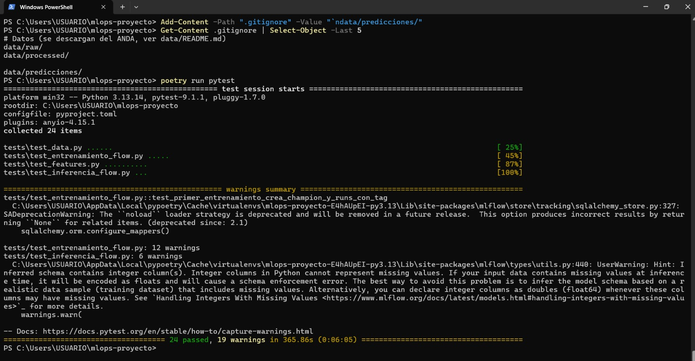

*Figura 8. Resultado real de Pytest con 24 pruebas aprobadas y las advertencias registradas.*

### 5. Ejecución de inferencia por lotes

Se lanzó el flujo desde la raíz del proyecto:

```powershell
poetry run python flows/inferencia_flow.py
```

La ejecución **`frisky-dolphin`** terminó en estado `Completed`. La tarea `cargar_champion` recuperó la **versión 1** del modelo y su run de entrenamiento; la tarea `ingesta` seleccionó un lote de **500 establecimientos de 2024** entre 6.420 disponibles. Las tareas `predecir` y `registrar_inferencia` generaron el archivo local y registraron el experimento en MLflow.

```text
Modelo cargado: eam-imputacion-prodbind versión 1
Lote de 500 establecimientos de 2024 (de 6420 disponibles)
Predicciones guardadas en data\predicciones\predicciones_2026-11-07.csv
Flow run 'frisky-dolphin' - Finished in state Completed()
```

El CSV `data/predicciones/predicciones_2026-11-07.csv` fue comprobado en PowerShell (33.207 bytes). Contiene las columnas `nordest`, `periodo`, `dpto`, `ciiu4`, `produccion_estimada`, `produccion_reportada`, `desviacion_log` y `alerta`.

A modo de verificación, el establecimiento anonimizado `975519` presentó una producción estimada de **20.479.189**, frente a **12.049.790** reportados, con `desviacion_log = -0,53036` y `alerta = True`. La marca es una señal para revisión analítica, no una conclusión automática sobre un error de reporte.

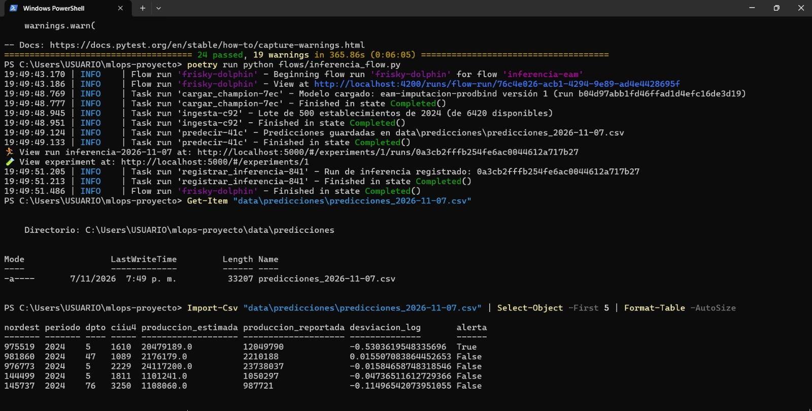

*Figura 9. Flujo completado, archivo de predicciones generado y cinco observaciones verificadas.*

### 6. Despliegues y programación diaria en Prefect

Se inició el servidor de despliegues con:

```powershell
poetry run python flows/desplegar.py
```

La terminal confirmó que Prefect estaba sirviendo los despliegues y consultando las ejecuciones programadas (*polling for scheduled runs*).

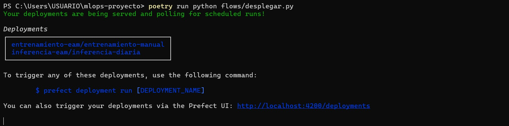

*Figura 10. La terminal muestra los dos despliegues servidos por Prefect.*

Los despliegues registrados fueron **`entrenamiento-eam/entrenamiento-manual`**, para ejecuciones bajo demanda, e **`inferencia-eam/inferencia-diaria`**, programado todos los días a las 06:00 en `America/Bogota`.

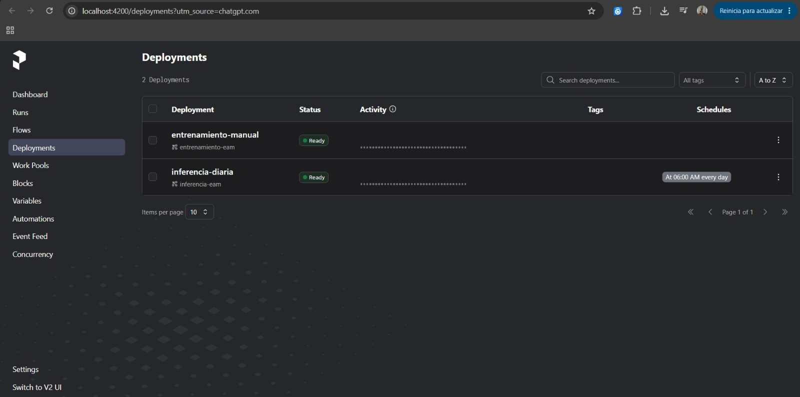

*Figura 11. Ambos despliegues aparecen con estado `Ready`; la inferencia muestra la programación diaria.*

La vista de detalle confirmó el horario y la primera ejecución automática prevista para el **8 de noviembre de 2026, a las 06:00**. Esta evidencia documenta la configuración del horario; no equivale a demostrar que una corrida programada efectivamente se ejecutó al día siguiente.

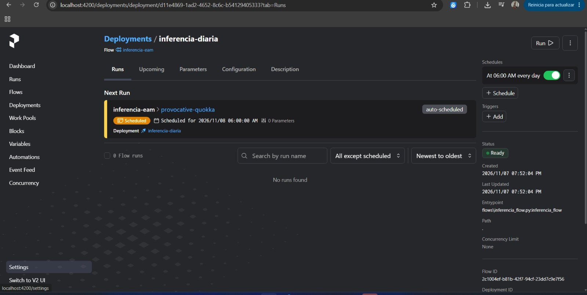

*Figura 12. Despliegue `inferencia-diaria` con programación activa a las 06:00.*

### 7. Prueba manual, incidencia y corrección

Se solicitó una ejecución inmediata desde el botón **Run** de Prefect. La primera ejecución, `fantastic-lionfish`, terminó `Failed`, aun cuando había completado la carga del champion, la ingesta y las predicciones. El fallo se localizó en `registrar_inferencia`, cuando MLflow intentó escribir un emoji en la salida estándar de Windows, configurada con `cp1252`:

```text
UnicodeEncodeError: 'charmap' codec can't encode character '\U0001f3c3'
```

Se detuvo el proceso `prefect serve` con `Ctrl + C`, se configuró la codificación UTF-8 en esa terminal y se reinició el servicio:

```powershell
$env:PYTHONIOENCODING = "utf-8"
poetry run python flows/desplegar.py
```

Sin cambiar el código del flujo ni el modelo, se solicitó nuevamente una ejecución desde la interfaz. La nueva corrida **`tunneling-macaque` finalizó `Completed` en aproximadamente 10 segundos**. La prueba confirma que el despliegue puede iniciar y completar la inferencia a demanda, y que el error de caracteres se resolvió en el proceso de ejecución.

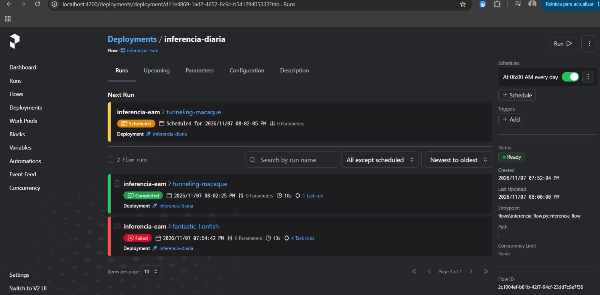

*Figura 13. Prefect conserva la corrida fallida inicial y muestra `tunneling-macaque` finalizada en `Completed` tras la corrección UTF-8.*

**Consideración operativa:** la ejecución diaria depende de que permanezcan activos Docker, el servidor de Prefect y el proceso que sirve los despliegues. La variable `PYTHONIOENCODING` se aplicó a la sesión de PowerShell utilizada; si se reinicia el servicio en otra sesión o equipo, debe definirse nuevamente o persistirse en la configuración del entorno.

### 8. Trazabilidad de la inferencia en MLflow

En el experimento `eam-imputacion-a2` se verificó el run `inferencia-2026-11-07` asociado a la ejecución exitosa del despliegue, con **estado `Finished`**, **modelo versión 1**, y tags `fase: inferencia` y `modelo_run_id`. La captura identifica el run `20c7173a24534123b786d3af8af037ef`.

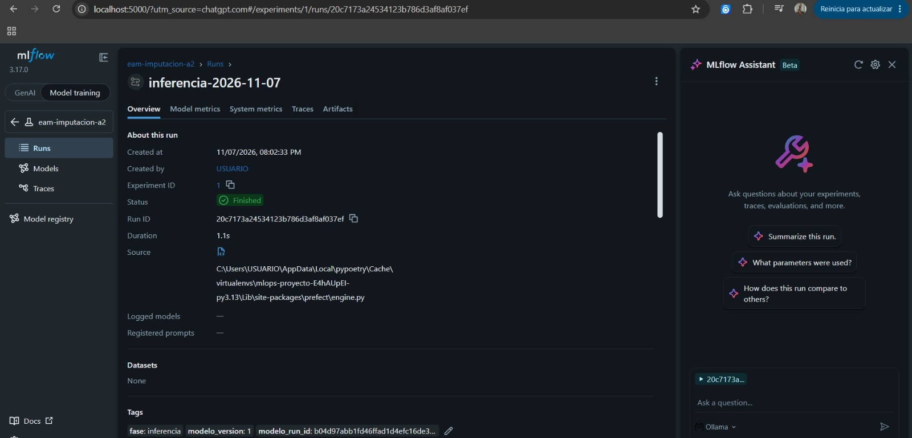

*Figura 14. Run finalizado en MLflow, con información de trazabilidad del modelo utilizado.*

El registro de métricas y artefactos se realiza desde el flujo de inferencia; su consulta en MLflow permite auditar qué versión del modelo se utilizó en la predicción. La captura aportada acredita el estado del run y sus tags, sin mostrar en detalle cada métrica o el listado de artefactos.

### 9. Control de versiones y publicación

Antes de preparar el commit se revisó `git status`: figuraban tres archivos nuevos y una modificación de `.gitignore`, sin Excel ni CSV entre los cambios:

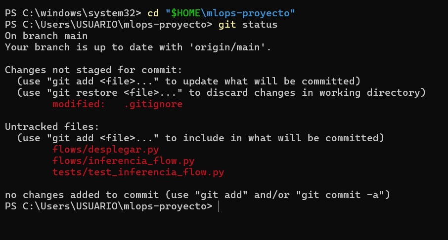

*Figura 15. Estado local previo al commit, con únicamente los cuatro archivos previstos.*

Se agregaron exclusivamente los archivos del componente:

```powershell
git add .gitignore flows/desplegar.py flows/inferencia_flow.py tests/test_inferencia_flow.py
git diff --cached --stat
git commit -m "feat: inferencia diaria y despliegues Prefect"
git push
```

Git informó **4 archivos y 211 inserciones**. El commit **`0607ec8`** se publicó en `main` bajo la cuenta autenticada de Natalia. Se actualizó también la dirección remota a `https://github.com/DuvanCruzMendoza/mlops-proyecto.git`. Al finalizar, `git status` indicó: `nothing to commit, working tree clean`.

### 10. Conclusiones

En el equipo de Natalia se reprodujo la ingesta, se creó el champion local y se validó el flujo de inferencia mediante **24 pruebas satisfactorias**, predicciones para **500 establecimientos**, registro verificable en MLflow y dos despliegues en Prefect. La programación diaria quedó configurada a las 06:00 y una ejecución manual desde el despliegue finalizó en `Completed`. La incidencia de codificación permitió comprobar el diagnóstico y la corrección del entorno sin modificar el código del modelo.

La contribución quedó publicada en GitHub con el commit `0607ec8`, lista para su incorporación al servicio de API y para la integración general del equipo.

---

## Parte III. API FastAPI y cambio de versión del champion — Paula

### 1. Objetivo y alcance

Esta sección documenta el **servicio de predicción**: una API construida con FastAPI que expone el modelo registrado en MLflow con el alias `champion`. Su propósito es que cualquier usuario o sistema pueda solicitar la producción bruta estimada de un establecimiento enviando sus datos, sin necesidad de abrir un notebook ni ejecutar el flujo de entrenamiento.

La API cierra el ciclo que inicia el entrenamiento: el flujo decide qué modelo es el `champion` y la API lo sirve. Por eso, aquí también se demuestra el **criterio de éxito de la actividad**: cuando el entrenamiento promueve una versión nueva, basta con reiniciar la API para que responda con ella, sin modificar una sola línea de código.

### 2. Preparación del entorno

La API se ejecutó en un equipo distinto al de los demás integrantes y con **Python 3.13**, a diferencia de la versión 3.12 usada en la configuración inicial. Esto sirvió como prueba adicional de reproducibilidad: el entorno se reconstruyó únicamente a partir de `pyproject.toml` y `poetry.lock`.

Primero se actualizó la copia local del repositorio con los aportes de Duván (entrenamiento) y Natalia (inferencia y despliegues), y se reinstaló el entorno:

```powershell
git pull
poetry install
```

Los cinco archivos Excel de la EAM se ubicaron en `data/raw/` y se generó el archivo consolidado:

```powershell
poetry run python scripts/load_data.py
```

El resultado coincidió con el de los demás integrantes: **34.552 registros, 16 columnas, 0 nulos y 7.659 establecimientos**. Que tres equipos distintos obtengan exactamente las mismas cifras confirma que la carga de datos es determinista.

Los servicios se levantaron con Docker Compose desde la carpeta `services/` del repositorio del curso. Como ese repositorio no estaba clonado en este equipo, fue necesario clonarlo antes:

```powershell
git clone https://github.com/henrycala/santoto-mlops-content.git
cd santoto-mlops-content\services
docker compose up -d
```

Se verificó que MLflow (`localhost:5000`) y Prefect (`localhost:4200`) respondieran antes de continuar.

### 3. Dependencias de la API

Se declararon explícitamente las librerías del servicio, con versión fijada:

```powershell
poetry add "fastapi==0.150.0" "uvicorn==0.54.0"
poetry add --group dev "httpx==0.28.1"
```

Poetry informó que no había paquetes nuevos por instalar, porque FastAPI y Uvicorn ya llegaban como dependencias internas de Prefect. Aun así, declararlas en `pyproject.toml` es importante: si en el futuro Prefect dejara de incluirlas, la API seguiría funcionando. `httpx` se agregó solo al grupo de desarrollo, porque lo usan las pruebas automáticas para simular peticiones.

### 4. Diseño de la API

| Archivo | Propósito |
|---|---|
| `api/main.py` | Cargar el modelo `champion` desde MLflow y exponer los endpoints. |
| `api/__init__.py` | Permitir que la carpeta se importe como módulo. |
| `tests/test_api.py` | Validar la carga del modelo, las predicciones, los errores y el cambio de versión. |

**Carga por alias, no por versión.** Al arrancar, la API lee el nombre del modelo desde `configs/config.yaml` (`registro.nombre_modelo`) y carga `models:/eam-imputacion-prodbind@champion`. En ningún lugar del código aparece un número de versión fijo. Esta decisión es la que permite cambiar de modelo sin tocar el código: la API siempre pregunta a MLflow cuál es el `champion` vigente.

**Carga única al inicio.** El modelo se carga una sola vez, cuando arranca el servidor, y no en cada petición. Así cada predicción responde en milisegundos. La contrapartida es que, si el entrenamiento promueve un `champion` nuevo, la API debe reiniciarse para tomarlo. Es un comportamiento intencional y está documentado en el README.

**Endpoints:**

| Endpoint | Método | Descripción |
|---|---|---|
| `/health` | GET | Estado del servicio, nombre del modelo y versión del `champion` cargado. |
| `/predict` | POST | Producción bruta estimada de un establecimiento. |
| `/docs` | GET | Documentación interactiva (Swagger), generada automáticamente por FastAPI. |

**Datos de entrada.** El endpoint `/predict` recibe los datos de un establecimiento con los mismos nombres de columna de la EAM: departamento, actividad CIIU, personal, salarios, prestaciones, energía, activos, depreciación e inversión. Como el `champion` se entrenó con rezagos, también recibe cuatro datos del año anterior: `prod_ant`, `persocu_ant`, `salarper_ant` y `eelec_ant`.

La API reutiliza la función `calcular_variables` de `scripts/features.py`, la misma del entrenamiento. Así, los logaritmos y las variables derivadas se calculan exactamente igual al entrenar y al predecir, lo que evita uno de los errores más frecuentes al llevar un modelo a producción. La respuesta devuelve la producción en pesos (se deshace el logaritmo con la exponencial) y la versión del modelo que la calculó, para que cada predicción sea trazable.

**Validaciones.** Pydantic rechaza con código `422` los valores imposibles, como un personal ocupado negativo. Si el modelo necesita los datos del año anterior y no se envían, la API también responde `422`, con un mensaje que indica exactamente qué falta, en lugar de fallar con un error interno.

### 5. Creación del primer champion en este equipo

Cada integrante tiene su propio servidor de MLflow, así que el modelo entrenado por Duván no existía en este equipo. Para probar la API y, sobre todo, el cambio de versión, el entrenamiento se ejecutó dos veces en un orden pensado para la demostración: primero con menos variables y después con todas.

En la primera ejecución se configuró `seleccion: CUSTOM` en `configs/features.yaml`:

```powershell
$env:PREFECT_API_URL = "http://localhost:4200/api"
$env:MLFLOW_TRACKING_URI = "http://localhost:5000"
poetry run python flows/entrenamiento_flow.py
```

```text
Features: CUSTOM (9 variables)
Versión 1 es el nuevo champion (MAE 0.2131, primer champion)
```

El MAE coincidió con el obtenido por Duván para la misma configuración (0,2131), otra confirmación de que el entrenamiento es reproducible entre equipos.

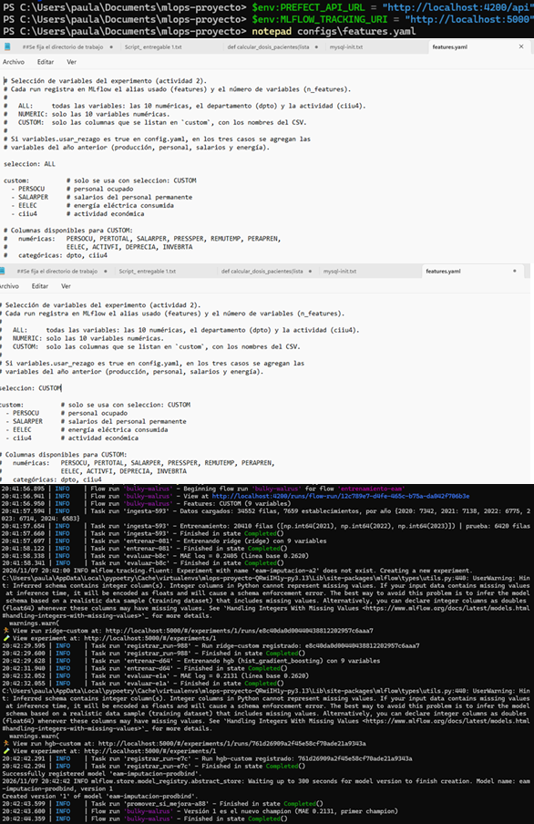

*Figura 16. Primera ejecución del entrenamiento en el equipo de la API.*

### 6. Prueba de la API con la versión 1

Se inició el servidor desde la raíz del repositorio:

```powershell
poetry run uvicorn api.main:app --port 8000
```

Al arrancar, la API confirmó qué modelo había cargado:

```text
API lista con eam-imputacion-prodbind versión 1
```

Desde la documentación interactiva (`http://localhost:8000/docs`) se probaron los dos endpoints.

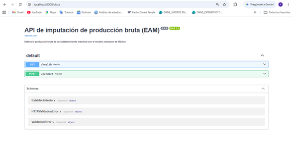

*Figura 17. Endpoints `/health` y `/predict` disponibles en `/docs`.*

`GET /health` respondió con código 200:

```json
{
  "estado": "ok",
  "modelo": "eam-imputacion-prodbind",
  "version": "1"
}
```

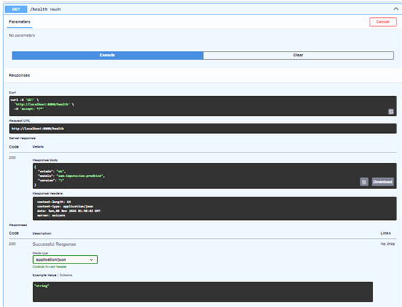

*Figura 18. La API informa que sirve la versión 1 del modelo.*

Para `POST /predict` se usó el ejemplo documentado en la API: un establecimiento construido con los **valores medianos de la EAM 2024**, que no corresponde a ninguna empresa real. Se eligieron valores medianos para que el ejemplo fuera representativo y, a la vez, no expusiera información de un establecimiento, en coherencia con la reserva estadística.

```json
{
  "dpto": 11, "ciiu4": 1410,
  "PERSOCU": 24, "PERTOTAL": 44, "SALARPER": 696000, "PRESSPER": 161000,
  "REMUTEMP": 0, "PERAPREN": 1, "EELEC": 164000, "ACTIVFI": 3262000,
  "DEPRECIA": 157000, "INVEBRTA": 61000,
  "prod_ant": 7569000, "persocu_ant": 23, "salarper_ant": 654000, "eelec_ant": 163000
}
```

Respuesta (código 200):

```json
{
  "produccion_estimada": 7844579,
  "log_produccion_estimada": 15.8753,
  "modelo": "eam-imputacion-prodbind",
  "version_modelo": "1"
}
```

La estimación (7.844.579) es cercana a la producción del año anterior (7.569.000) y algo mayor, lo cual es razonable: el personal, los salarios y la energía del establecimiento crecieron levemente frente al año previo.

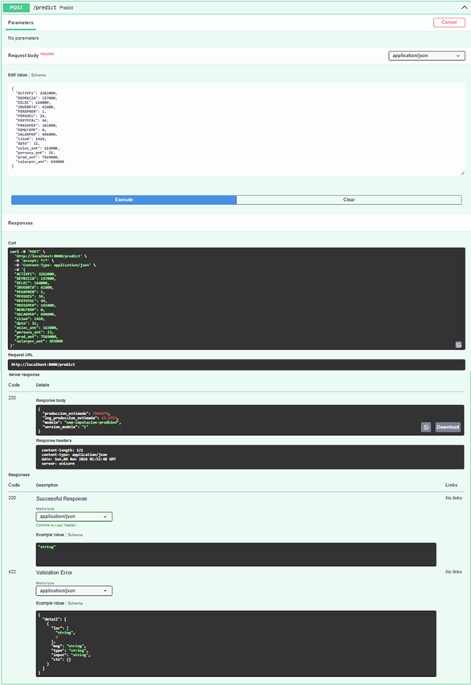

*Figura 19. Petición y respuesta de `/predict` con el champion versión 1.*

### 7. Criterio de éxito: nuevo champion sin cambiar código

Con la API todavía en ejecución, se abrió una segunda terminal, se cambió la configuración a `seleccion: ALL` y se volvió a entrenar:

```text
Features: ALL (17 variables)
Versión 2 es el nuevo champion (MAE 0.2041, reemplaza a v1)
```

El candidato cumplió las tres condiciones de promoción: MAE menor a 0,30, menor que la línea base (0,2620) y menor que el `champion` vigente (0,2131). MLflow registró la versión 2 y le movió el alias `champion`.

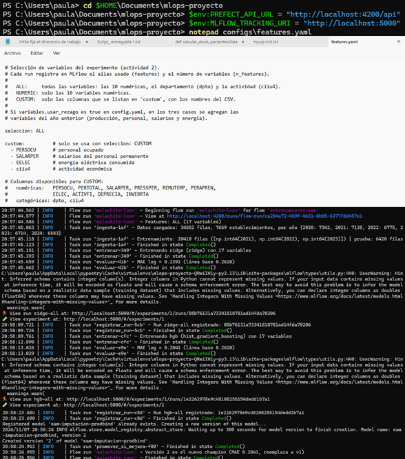

*Figura 20. Promoción de un nuevo champion.*

En este punto la API seguía respondiendo con la versión 1, porque el modelo se carga al arrancar. Se detuvo con `Ctrl + C` y se inició de nuevo con el **mismo comando**:

```text
INFO:     Shutting down
INFO:     Application shutdown complete.
...
API lista con eam-imputacion-prodbind versión 2
```

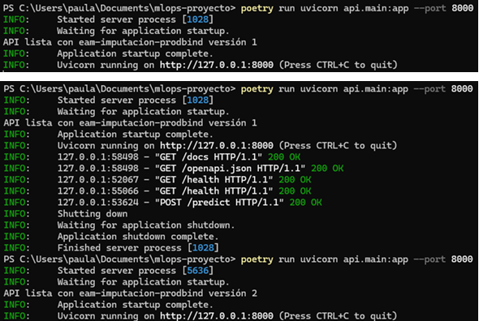

*Figura 21. La misma terminal muestra la API sirviendo la versión 1, su apagado y el nuevo arranque con la versión 2.*

Se repitió la petición con **exactamente el mismo cuerpo**:

```json
{
  "produccion_estimada": 7900082,
  "log_produccion_estimada": 15.8824,
  "modelo": "eam-imputacion-prodbind",
  "version_modelo": "2"
}
```

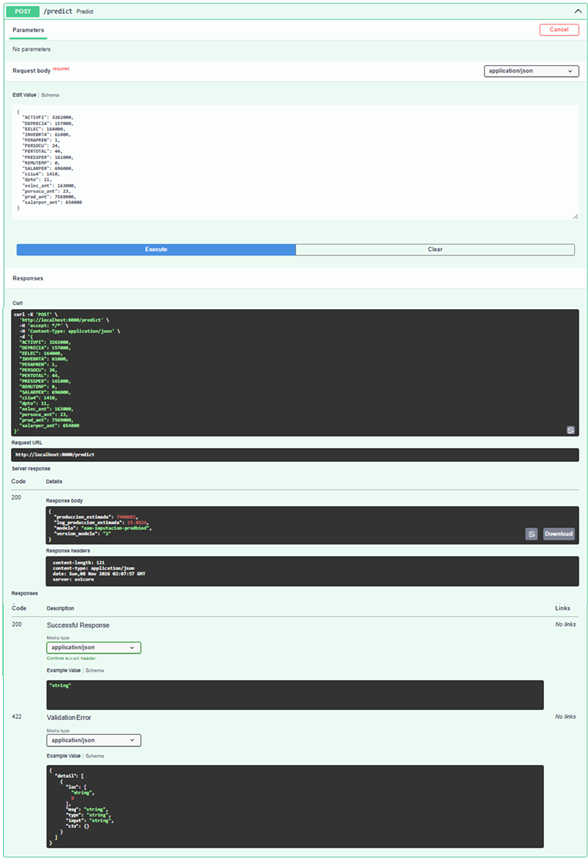

*Figura 22. Mismo establecimiento, nueva versión del modelo.*

| Momento | Champion | Variables | MAE log | Producción estimada |
|---|---|---:|---:|---:|
| Antes del reentrenamiento | Versión 1 (CUSTOM) | 9 | 0,2131 | 7.844.579 |
| Después de reiniciar la API | Versión 2 (ALL) | 17 | 0,2041 | 7.900.082 |

La diferencia entre las dos estimaciones es de apenas 0,7 %, algo esperable porque ambos modelos aprenden del mismo histórico. Lo relevante es que la respuesta **identifica la versión que la produjo** y que el cambio se logró solo con un reentrenamiento y un reinicio, sin editar `api/main.py`. Con esto se cumple el criterio de éxito de la actividad.

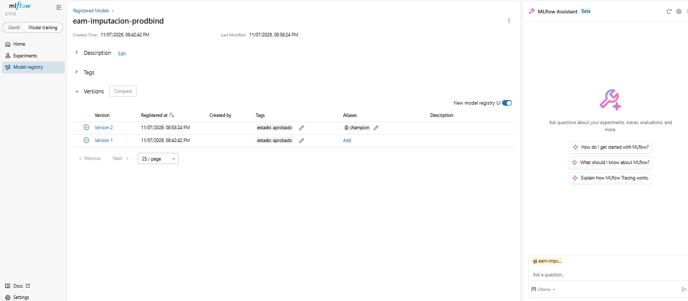

*Figura 23. En MLflow, la versión 2 tiene el alias `champion`.*

Al terminar se restableció `seleccion: ALL`, que es el valor predeterminado del repositorio, y se verificó con `git status` que `configs/features.yaml` no quedara modificado.

### 8. Pruebas automatizadas

Se ejecutó la batería completa, que ya incluía los componentes de los tres integrantes:

```powershell
poetry run pytest
```

```text
28 passed
```

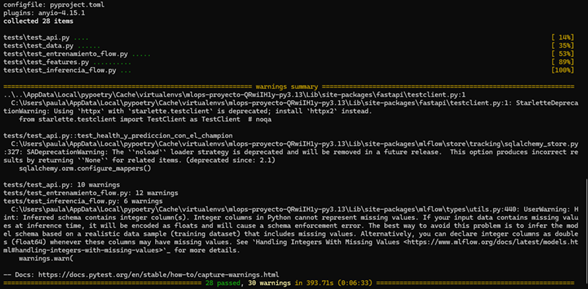

*Figura 24. Las pruebas de entrenamiento, inferencia y API finalizan sin fallos.*

Las cuatro pruebas de `tests/test_api.py` cubren:

1. **Carga y predicción:** la API carga el `champion`, `/health` informa su versión y `/predict` devuelve una producción positiva.
2. **Datos del año anterior faltantes:** la API responde `422` con un mensaje explicativo.
3. **Datos inválidos:** un personal ocupado negativo es rechazado con `422`.
4. **Cambio de versión:** se entrena una versión 1, luego una versión 2 que la mejora, y se comprueba que la API "reiniciada" responde con la 2. Es el criterio de éxito convertido en una prueba automática.

Las pruebas usan datos simulados y un MLflow temporal, por lo que no dependen de los Excel ni modifican el servidor de MLflow del equipo. Al final de la ejecución, Prefect imprime mensajes de *"Logging error"* al cerrar su servidor temporal; no son fallos, y el resultado válido es la línea `passed`.

### 9. Control de versiones y publicación

Se agregaron solo los archivos del componente, uno por uno, para evitar subir por error datos, predicciones o documentos de trabajo:

```powershell
git add api/__init__.py api/main.py tests/test_api.py README.md pyproject.toml poetry.lock
git commit -m "feat: API FastAPI que sirve el modelo champion"
git push
```

El commit **`f58199f`** registró **seis archivos**, con **310 inserciones y 47 eliminaciones**. Además del código de la API, incluyó la actualización del README con la sección *API de inferencia* y la **predicción de ejemplo documentada**, que es uno de los entregables de la actividad.

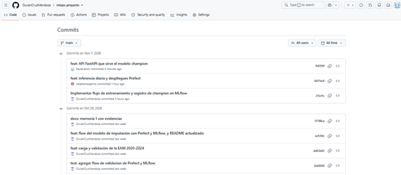

*Figura 25. Historial del repositorio con los commits de los tres integrantes.*

Con este commit, el historial del repositorio refleja la división real del trabajo: el entrenamiento (Duván, `215cf1c`), la inferencia y los despliegues (Natalia, `0607ec8`) y la API (Paula, `f58199f`).

### 10. Problemas encontrados

- **Repositorio del curso ausente.** En la actividad 1 los servicios se habían levantado en otro equipo, así que la carpeta `services/` no existía localmente. Se resolvió clonando el repositorio del curso.
- **Cambios de configuración sin guardar.** Al editar `features.yaml` con el Bloc de notas, el cambio a `CUSTOM` solo se aplica después de guardar el archivo. La línea `Features: CUSTOM (9 variables)` al inicio del flujo permitió confirmar que se estaba usando la configuración correcta.
- **Autenticación en GitHub.** El primer `git push` desde este equipo quedó en espera hasta autorizar Git en el navegador. Mientras tanto, el commit existía localmente pero no aparecía en GitHub.
- **Avisos de fin de línea.** Git mostró advertencias `LF will be replaced by CRLF`, propias de trabajar en Windows con archivos creados en otro sistema. No afectan el contenido.
- **Lectura de la documentación de Swagger.** La sección *Responses* de `/docs` muestra ejemplos genéricos (`"string"`) de las respuestas 200 y 422. El resultado real aparece más arriba, en *Server response*.

### 11. Conclusiones

La API completa el recorrido del modelo, desde los datos hasta un servicio consultable. Al cargar el modelo por su alias y no por un número de versión, el código de la API queda desacoplado del ciclo de entrenamiento: el flujo decide qué modelo es el mejor y la API simplemente lo sirve. La demostración con el mismo establecimiento antes y después del reentrenamiento (7.844.579 con la versión 1 y 7.900.082 con la versión 2) evidencia el criterio de éxito sin modificar código.

La ejecución en un tercer equipo, con otra versión de Python, reprodujo exactamente los resultados de los demás integrantes (34.552 registros, MAE de 0,2131 y 0,2041). Esto respalda que el proyecto es reproducible, que es el objetivo de fondo del curso.

Con más tiempo, la API podría mejorarse con:

- **Recarga del modelo sin reinicio**, por ejemplo con un endpoint protegido que vuelva a consultar el alias `champion`.
- **Predicción por lotes**, para imputar varios establecimientos en una sola petición.
- **Intervalos de predicción**, para indicar qué tan confiable es cada estimación.
- **Empaquetado en Docker**, para desplegarla junto a MLflow y Prefect.

---

## Parte IV. Integración final

Con los tres componentes publicados, se integró el sistema completo en el equipo de Duván:

```powershell
git pull
poetry install
poetry run pytest
```

Resultado: `28 passed, 30 warnings in 154.52s`. El repositorio quedó con la siguiente estructura de componentes:

| Componente | Archivos | Integrante | Commit |
|---|---|---|---|
| Configuración y entrenamiento | `configs/`, `scripts/features.py`, `flows/entrenamiento_flow.py` y sus pruebas | Duván | `215cf1c` |
| Inferencia y despliegues | `flows/inferencia_flow.py`, `flows/desplegar.py` y su prueba | Natalia | `0607ec8` |
| API y documentación integrada | `api/`, `tests/test_api.py`, `README.md`, dependencias | Paula | `f58199f` |

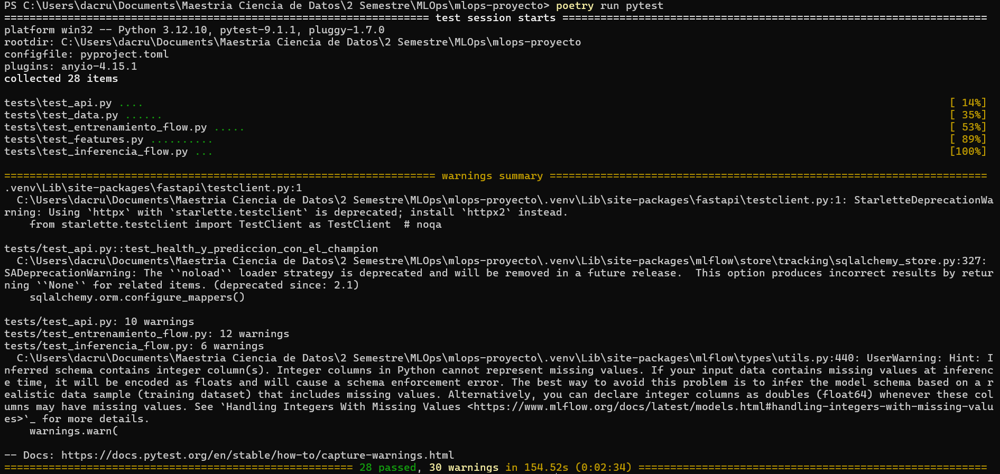

*Figura 26. Ejecución de las 28 pruebas en el equipo de integración.*

Con Prefect y MLflow activos, se ejecutó la inferencia y se inició la API sobre el champion del equipo de integración (versión 1, entrenada con `ALL`). La inferencia (`sparkling-husky`) terminó en `Completed` y generó `data/predicciones/predicciones_2026-11-08.csv` con 500 establecimientos de 2024. La API respondió `/health` con la versión 1 y `/predict` con una producción estimada de **7.900.082** para el establecimiento de ejemplo, el mismo valor que obtuvo el modelo equivalente (versión 2) en el equipo de la API. Esto confirma que el sistema integrado funciona y que los resultados se reproducen entre equipos.

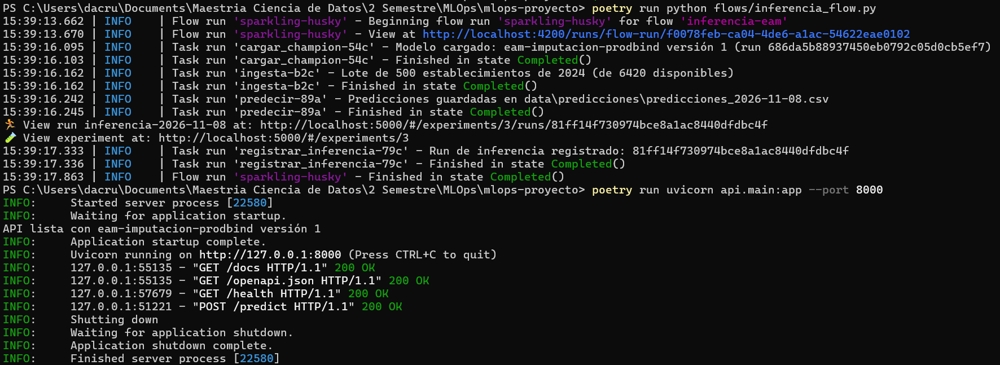

*Figura 27. La inferencia carga el champion versión 1 y guarda el CSV del día; la API arranca con la misma versión y responde `200 OK` a `/health` y `/predict`.*

---

## Conclusiones generales

El equipo construyó el ciclo completo de un modelo de imputación de la producción bruta industrial: un pipeline de entrenamiento que solo promueve un modelo cuando mejora al vigente, una inferencia por lotes programada a diario y una API que sirve siempre el `champion`. Los tres componentes se comunican a través del Model Registry de MLflow y del alias `champion`, no de números de versión, por lo que un nuevo modelo entra en servicio sin modificar código.

Los resultados se reprodujeron en los tres equipos con los mismos valores (34.552 registros, MAE log de 0,2131 con `CUSTOM` y 0,2041 con `ALL`), lo que respalda la reproducibilidad del proyecto. El mejor modelo, HistGradientBoosting con todas las variables y rezagos, reduce el error un 22 % frente a la línea base del año anterior.

Como trabajo futuro se plantean la recarga del modelo en la API sin reinicio, la predicción por lotes desde la API, intervalos de predicción y el empaquetado de los servicios en Docker para no depender de terminales abiertas.

---

## Uso de herramientas de inteligencia artificial

**Herramientas utilizadas.** El equipo usó **Claude** (Anthropic) y **ChatGPT** (OpenAI) como apoyo:

- **Claude:** preparación del código de los tres componentes (`flows/entrenamiento_flow.py`, `scripts/features.py`, las configuraciones YAML, `flows/inferencia_flow.py`, `flows/desplegar.py`, `api/main.py` y sus pruebas), y revisión de la redacción de esta memoria. Paula también lo usó durante la ejecución de la API para interpretar la guía y resolver errores de terminal.
- **ChatGPT:** apoyo a Natalia durante la instalación del entorno, la ejecución del pipeline de inferencia y el diagnóstico del error de codificación de Windows, para interpretar mensajes de terminal y formular comandos de PowerShell.

**Decisiones y trabajo del equipo.** Las decisiones de fondo fueron del equipo: la variable objetivo, el uso de rezagos, la división temporal, el reemplazo del AUC por el MAE y los criterios de promoción. Cada integrante integró los archivos en el repositorio, instaló el entorno en su propio equipo, ejecutó los entrenamientos, la inferencia, los despliegues, la API y las pruebas, revisó los resultados en Prefect y MLflow, tomó las capturas y publicó su commit con su cuenta de GitHub.

**Revisión de las salidas de la IA.** Los resultados esperados según las guías se contrastaron con los obtenidos en cada equipo (versiones del modelo, MAE, predicciones y número de pruebas). Se agregaron a Git solo los archivos de cada componente, se verificó que los commits aparecieran a nombre de cada integrante y se diagnosticó y corrigió la incidencia de codificación sin modificar el código del modelo. Todos los resultados citados en esta memoria corresponden a ejecuciones reales en los equipos de los integrantes.
